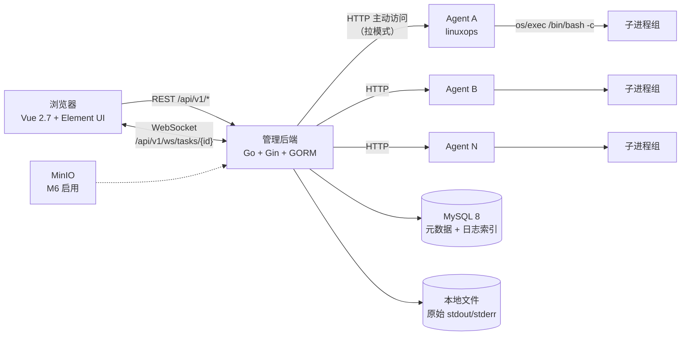
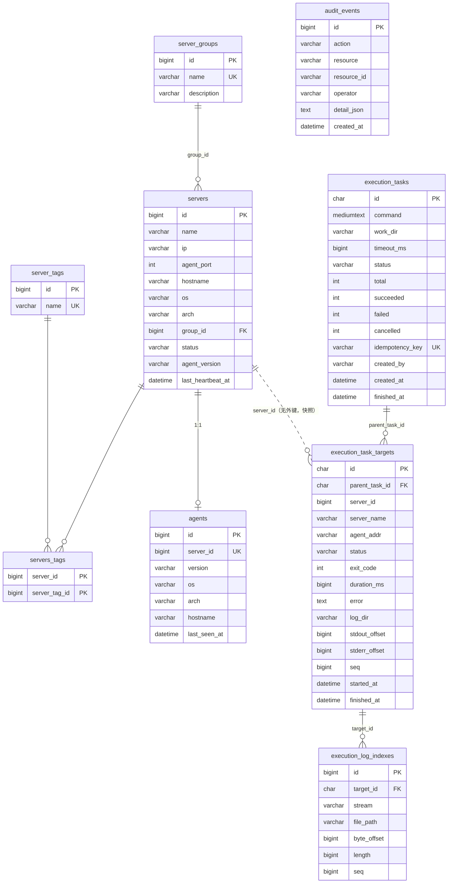
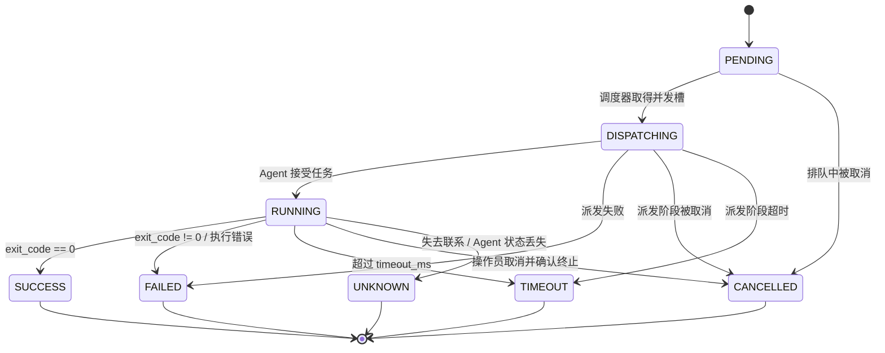
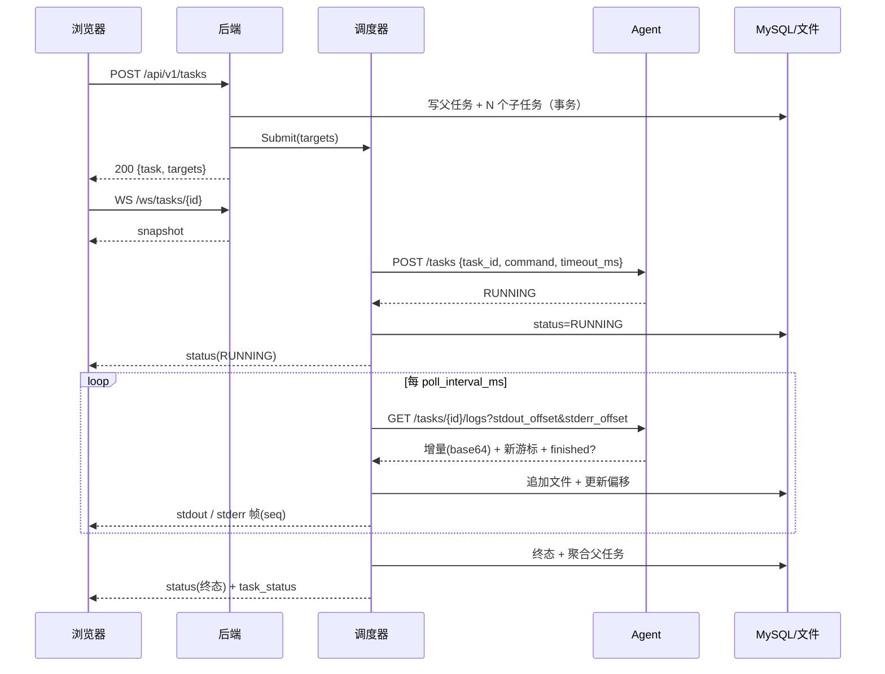

# Linux 集中运维平台 — 架构设计

> 本文描述当前已实现范围的组件、通信方向、数据模型、状态机与可靠性策略，
> 并保留后续里程碑（M5/M6/M7/M8）的演进设计。已实现范围见
> [overview.md §4](overview.md#4-功能清单)。

## 1. 范围

已实现：

- 服务器 / 分组 / 标签管理，Agent 版本与在线状态
- 单机与批量命令执行（非交互），`bash -c`
- stdout / stderr 实时输出（WebSocket），退出码、耗时
- 任务状态机：取消、超时、失败、未知、后端重启恢复
- 日志落盘 + 分段索引；REST 回放与下载
- 任务历史、`anonymous` 审计
- 交互式终端（PTY + WebSocket + xterm.js）
- 文件管理（浏览、编辑、上传、下载、重命名、删除）
- Agent 自更新（MinIO 制品桶扫描、SHA256 校验、原地重启）
- 统一访问口令登录（单一口令，非多用户认证）
- 前端：登录、概览、服务器、命令执行、文件、终端、任务历史

明确不包含：

- 多用户、RBAC、JWT、API Token、Agent 认证、mTLS、命令审批、审计防篡改
- 命令模板库（M5）、MinIO 大日志（M6）、高可用（M7）

## 2. 安全边界（重要）

平台有**统一访问口令**（`auth.access_password`），但这不是真正的认证与授权：
口令是全局共享的，没有用户身份、权限模型或操作人区分；后端到 Agent、浏览器到
后端的链路都是明文 HTTP。因此：

- 后端默认监听 `127.0.0.1:8080`，Agent 默认监听 `127.0.0.1:19090`
- 跨机使用时，运维必须显式把监听地址改为**内网地址**，并用防火墙/安全组
  把端口限制到管理网段
- 严禁暴露到公网；禁止将其描述为「生产安全」
- 审计 operator 恒为 `anonymous`，系统不提供伪造身份或绕过审计的能力
- 所有执行以 Agent 进程的 systemd 用户（默认 `linuxops`，非 root）权限运行；
  需要特权的命令应通过显式的 sudoers 条目单独授权，而不是让 Agent 以 root 运行

正式生产必须先完成 M8 安全加固（认证、授权、Agent 身份、传输加密、审批流）。

## 3. 总体架构



要点：

- 通信方向由 **后端主动访问 Agent**，Agent 不回连后端、不感知后端地址。
- 后端是本平台的唯一状态权威；Agent 只保存自己内存中的执行记录。
- 三端独立构建：`frontend/`、`backend/`、`agent/`；后端与 Agent 各有独立 `go.mod`。
- Agent 为纯 Go，可 `CGO_ENABLED=0` 交叉编译 linux/amd64、linux/arm64。

## 4. 关键设计决策

### 4.1 拉模式

后端在调度协程中调用 Agent 的 HTTP API。好处：

- Agent 无需出站连接，部署在受限网络中更容易
- 后端可以统一施加超时、重试、并发与审计
- 后端天然是幂等与状态机的实现点

代价：后端到 Agent 端口的网络必须连通；由部署文档与 ACL 保证。

### 4.2 心跳与在线状态

后端 `heartbeat_interval_sec`（默认 20s）轮询所有服务器的
`GET /api/v1/info`，更新：

- `servers.status` = `online` / `offline`
- `servers.agent_version`、`hostname`、`os`、`arch`、`last_heartbeat_at`
- `agents` 表（与 servers 1:1）

手动 `POST /agents/check`（body `{server_ids:[...]}`）复用同一条探测路径，
一次刷新多台服务器，便于批量排障。

### 4.3 游标拉取日志

Agent 为每个任务保留两个 `cappedBuffer`（stdout/stderr），每个上限
`max_output_bytes`（默认 10 MiB），超限截断并标记 `truncated`。

后端按 `poll_interval_ms`（默认 300ms）调用：

```
GET /api/v1/tasks/{id}/logs?stdout_offset=X&stderr_offset=Y&limit=N
```

Agent 返回从 `X`/`Y` 开始的增量（base64）与新的游标。后端：

1. 解码、通过 `ws.Hub` 广播（分配单调 `seq`）
2. 追加到本地文件 `{log_dir}/{taskID}/{targetID}/{stream}.log`
3. 更新 `execution_task_targets.stdout_offset/stderr_offset/seq`
4. 每累计 64 KiB 写一条 `execution_log_indexes` 分段记录

游标持久化在 MySQL 中，因此后端重启后可从最后确认的位置继续拉取，不会重复落盘。

### 4.4 WebSocket 重放

`GET /api/v1/ws/tasks/{id}`：

- 连接后先收 `snapshot` 帧（所有 target 的当前状态 + 最后 seq）
- 每个 target 的帧有全局单调递增的 `seq`
- `ws.Hub` 为每个 target 保留 `replay_buffer_len`（默认 2000）帧的环形缓冲
- 客户端断线重连后发送
  `{"type":"subscribe","resume":{"<targetId>":<lastSeq>}}`，服务端从缓冲回放
  `seq > lastSeq` 的帧

环形缓冲只覆盖近期帧；更早的历史走 REST：
`GET /targets/{id}/logs?stream=stdout&offset=0&limit=...`（读落盘文件）。

后端重启后 Hub 的进程内 `seq` 会归零，因此启动恢复时会用数据库中持久化的
`seq` 重新播种计数器（`Hub.EnsureSeq`），保证断线后仍保留 `lastSeq` 的客户端
不会把新帧误判为重复。前端刷新页面时先用 REST 读取已落盘日志，再用响应中的
`seq` 作为重连游标，然后建立 WebSocket。

### 4.5 幂等与「绝不重复执行」

三层防护：

| 层 | 机制 |
|---|---|
| 前端/API | 可选 `idempotency_key`，命中已有父任务时直接返回原任务 |
| 后端 | `(parent_task_id, server_id)` 唯一索引，防止同一批次重复派发 |
| Agent | 以 `task_id`（即 target UUID）为键；已存在则返回当前状态，不重复执行 |

恢复策略刻意保守：后端重启后若 Agent 返回 404（Agent 也重启过、内存记录丢失），
该目标标为 `UNKNOWN` 而不是重新执行。**平台宁可报告未知，也不会重复执行命令。**

### 4.6 日志存储位置

当前使用本地文件 + MySQL 索引：

```
{log_dir}/{parentTaskID}/{targetID}/stdout.log
{log_dir}/{parentTaskID}/{targetID}/stderr.log
```

MinIO 不承载任务日志；它当前只用于存放 Agent 发布包（自更新源，见 §9.2）。
大日志方案仍是 §9.2 的设计目标，尚未实现。

## 5. 数据模型



设计说明：

- **父任务 / 子任务**：`execution_tasks` 是一次批量提交，`execution_task_targets`
  是每台服务器上的执行单元。父任务状态由子任务聚合得出。
- **历史快照**：子任务保存 `server_name` / `agent_addr` 快照，且**故意不设**
  到 `servers` 的外键。删除服务器不会破坏历史；API 也禁止删除仍有活跃任务的服务器。
- **日志偏移**：`stdout_offset` / `stderr_offset` 是重连续拉的游标，`seq` 是
  前端重放游标，两者互相独立。
- **时间**：全部以 UTC 写入（MySQL 连接 `loc=UTC`），前端本地化显示。
- **认证表**：不存在。不要添加半成品认证表，M8 再统一设计。

DDL 见 [database/schema.sql](../database/schema.sql)。两条路径二选一：
后端 GORM `AutoMigrate`（默认），或手工执行该 DDL 并关闭 `auto_migrate`。

## 6. 任务状态机

### 6.1 子任务（target）



状态含义：

| 状态 | 含义 |
|---|---|
| `PENDING` | 已入库，等待并发槽 |
| `DISPATCHING` | 正在向 Agent 提交任务 |
| `RUNNING` | Agent 已开始执行，后端在拉日志 |
| `SUCCESS` | 退出码为 0 |
| `FAILED` | 退出码非 0，或启动/派发失败 |
| `TIMEOUT` | 超过任务超时；后端已请求 Agent 终止 |
| `CANCELLED` | 操作员取消 |
| `UNKNOWN` | 后端无法确认结果（Agent 不可达或状态丢失）。**不猜测成功** |

### 6.2 父任务聚合

`AggregateStatuses` 的规则：

1. 任一子任务仍在 `PENDING/DISPATCHING/RUNNING` → 父任务 `RUNNING`
   （任务刚创建、所有目标还在队列中时保持 `PENDING`，首个目标派发时变为 `RUNNING`）
2. 全部 `SUCCESS` → `SUCCESS`
3. 全部 `CANCELLED` → `CANCELLED`
4. 其余全部终态 → `FAILED`

父任务同时维护 `total/succeeded/failed/cancelled` 计数。每次子任务收尾都会
重新聚合并广播 `task_status`。

### 6.3 取消与超时

- 取消：后端取消 context，调用 Agent `POST /tasks/{id}/cancel`；Agent 标记任务
  取消并 `kill(-pgid, SIGKILL)` 整个进程组，避免子进程残留（`Setpgid=true`）。
- 超时：后端对整轮执行施加 `timeout_ms`；到期后同样请求 Agent 终止，标 `TIMEOUT`。
- 后端关闭：不终止任务，行保持 `RUNNING`，下次启动 `Recover()` 继续跟踪。

## 7. 执行链路时序



## 8. 异常与恢复策略

| 场景 | 行为 |
|---|---|
| Agent 离线（派发时） | 子任务 `FAILED`，错误写入 `error` |
| Agent 在运行中不可达 | 连续 20 次轮询失败后标 `UNKNOWN`（默认约 6 秒），不猜测结果 |
| 后端重启 | 扫描 `PENDING/DISPATCHING/RUNNING`；可达则续拉日志；Agent 404 → `UNKNOWN` |
| 后端重启，任务已超时 | 按创建时间计算剩余预算；已超时则请求取消并标 `TIMEOUT` |
| 浏览器刷新 / WS 断线 | REST 重查状态 + WS 重订阅并携带 `resume` 游标 |
| 同一 `idempotency_key` 重复提交 | 返回原任务，不重复执行 |
| Agent 收到重复 `task_id` | 返回已有记录，不重复执行 |
| 输出超过上限 | 截断并标记 `truncated`，任务继续执行 |
| 取消时无法确认终止 | 记录错误日志；状态按后端视角收敛，绝不标为 `SUCCESS` |

## 9. 后续里程碑设计

### 9.1 M4 — 交互式终端（PTY）【已实现】

实现方式（不改变非交互路径）：

- Agent 提供 `GET /api/v1/ws/terminal` WebSocket，纯 Go 实现 PTY
  （保持 `CGO_ENABLED=0`），支持窗口缩放、Ctrl+C
- 后端在 `/api/v1/ws/terminal/:id` 做 WebSocket 代理，并限制并发会话数
  （`websocket.max_terminal_sessions`）
- 会话与任务分离：非交互任务继续走现有状态机；PTY 会话不落库
- 前端使用 xterm.js，独立页面 `/terminal` 与 `/servers/:id/terminal`
- 约束：空闲超时（默认 600s）、单会话最长时长（默认 3600s）、
  `history_mode: memory`（默认不写 `~/.bash_history`）
- 风险：PTY 扩大攻击面；仍只允许在隔离网络使用

### 9.2 Agent 自更新【已实现】

发布与发现：

- 发布包命名约定 `linux-ops-agent-<版本>-linux-<架构>.tar.gz`，上传到
  `update_base_url` 指向的 S3/MinIO 前缀即可，不依赖手工维护的 manifest。
- Agent 用匿名 `ListObjectsV2`（分页）列出该前缀，按文件名正则筛选出与自身
  `GOARCH` 匹配的版本，取高于当前版本的最大值；`manifest.json` 若存在则一并
  参考，取两者中较高版本，并可继承 notes 与 sha256。
- 校验和优先级：manifest → `SHA256SUMS` → 无（默认放行，
  `update_require_checksum: true` 时拒绝）。

安装与重启：

1. 下载 tarball → 校验 sha256 → 解包出 `agent` 可执行文件；
2. 旧文件备份为 `agent.old`，新文件原子替换 `os.Executable()`；
3. `syscall.Exec` 原地重启，PID 与日志重定向保持不变。

约束：升级前要求没有正在执行的任务（否则 409）；备份文件用于手工回滚。

### 9.3 M6 — MinIO 大日志（计划）

**升级**：

1. 新增配置 `storage.backend = file | minio`，默认 `file`
2. 写入路径抽象为 `logstore.Store` 接口（现有实现为 `fileStore`）
3. `minioStore` 将每个 target 的 stdout/stderr 写成对象
   `logs/{taskID}/{targetID}/{stream}.log`（或分段对象）
4. `execution_log_indexes.file_path` 改为对象键；`byte_offset`/`length` 语义不变
5. 下载接口在两种后端下行为一致；前端无改动
6. 迁移：历史文件继续可读（文件后端），新任务写 MinIO；索引中记录
   `storage` 字段以区分

**回滚**：

1. 把 `storage.backend` 改回 `file`，重启后端
2. 新任务写本地文件；MinIO 中已有对象保留（只读，不删除）
3. 如需把 MinIO 对象拉回本地，提供一次性 `scripts/migrate-logs.sh`
   （仅读取对象并写入本地文件 + 更新索引）
4. 任何情况下都不删除旧数据，直到验证完成

**风险**：MinIO 不可用会阻塞日志写入。升级时要求日志写入失败不阻塞任务执行，
只记录错误并保留游标（下次重试），避免因为存储故障导致任务误判。

### 9.4 M5 — 命令模板库（计划）

- 新表 `command_templates`、`command_template_versions`
- 模板渲染在**后端**完成，Agent 永远只收到最终命令
- 模板变量白名单校验，防止把未校验输入拼进 shell
- 审计记录模板 ID + 版本 + 渲染参数的哈希（不记录敏感值）

## 10. 风险清单

| 风险 | 影响 | 缓解 |
|---|---|---|
| 口令共享且明文传输 | 知道口令或抓到 Cookie 的人能执行任意命令 | 统一口令仅作访问门槛；隔离网络；默认 127.0.0.1；防火墙限制；M8 前不对外 |
| Agent 以普通用户运行 | 部分运维命令失败 | 显式 sudoers 条目；不推荐 root 运行 |
| Agent 内存保存任务 | Agent 重启后历史丢失 | 后端保守标 `UNKNOWN`；日志已落盘；不重复执行 |
| WS 环形缓冲有限 | 超长输出重连时可能丢帧 | 前端回退到 REST 日志接口；下载完整文件 |
| 轮询产生延迟 | 输出不是「逐字节实时」 | 默认 300ms；可调小；M4 PTY 提供真实时 |
| MySQL 单点 | 平台不可用 | 备份策略见部署文档；M7 再做高可用 |
| 本地文件日志增长 | 磁盘占满 | 需要日志清理策略（M6/运维脚本）；监控磁盘 |
| 无审计防篡改 | 审计可被有权限者修改 | 只读账号 + 外部日志收集；M8 设计 |
| CORS `*` | 浏览器跨站请求 | 隔离网络内可接受；生产需固定 origin |

## 11. 里程碑与验收

| 里程碑 | 内容 | 验收标准 | 状态 |
|---|---|---|---|
| M0 | 架构与数据模型 | 本文档 + DDL | 已完成 |
| M1 | 三端工程、部署、健康检查 | 三端可构建；后端能列出 Agent 状态 | 已完成（待 Linux 实测） |
| M2 | 单机真实执行闭环 | 前端提交命令，实时看到 stdout/stderr 与退出码 | 已完成（待 Linux 实测） |
| M3 | 批量、状态机、取消/超时、恢复 | 多机执行、取消、超时、后端重启恢复、重复任务不重复执行 | 已完成（待 Linux 实测） |
| M4 | 交互式终端 | xterm + PTY，会话审计 | 已完成（真实主机验证） |
| M5 | 命令模板库 | 模板 CRUD + 版本 + 渲染 | 未开始 |
| M6 | MinIO 大日志 + Agent 包升级 | 大日志读写、升级/回滚演练 | Agent 升级已完成；大日志未开始 |
| M7 | 高可用与容量 | 多后端、对象存储、容量测试 | 未开始 |
| M8 | 安全加固 | 认证、RBAC、mTLS、审批、审计防篡改 | 未开始 |

「待 Linux 实测」的准确含义见 [progress.md](progress.md)。
